# Bitácora y reflexiones — Caso 07: Player.prefab

Carolina Lohrmann · Integrante 1 · 16 de octubre de 2026

## Participantes

Carolina modificó la velocidad del prefab desde VS Code, creó su commit, realizó la integración y publicó el resultado en Dev. Kevin preparó el prefab en Unity, agregó Animator en su rama y realizó la comprobación en Unity. Cada participante tomó las capturas de sus propias operaciones; las imágenes de Unity y del commit de Kevin corresponden a él.

## Desarrollo

Kevin creó y publicó la base común `63ea6f9c85a93faa8ae3c1e8976adc7f869c0545`, con `Assets/02_Prefabs/Player.prefab`, su .meta y la escena con la instancia del prefab. La velocidad inicial del PlayerController era 5.

Desde esa base, Carolina trabajó en `Caso07/Carolina-Movimiento`. Cambió únicamente la propiedad serializada del prefab de `speed: 5` a `speed: 6`. Durante la edición se cambió inicialmente el valor por defecto del script, pero se devolvió a `5f` antes del commit. El aporte publicado fue `ef71520`, con el mensaje `feat: ajusta velocidad de Player prefab` y autor `carolinalohrmann`.

Kevin agregó el componente Animator al mismo prefab en `Feature_Animation`, también desde la base común. Su commit fue `05cd475b204c21631e74f76a68fff40096e22b60`, mensaje `feat: agrega Animator al prefab del Player`. Los tres cambios locales de configuración de Unity que mencionó quedaron fuera de ese aporte.

Carolina creó `Caso07/Integracion` desde su rama y combinó `origin/Feature_Animation`. Git realizó un merge automático, sin conflicto textual, generando `bd26a4f8a33ac370bccd7dde6da609ad2da4adde`. Se revisó el prefab y se conservaron la velocidad 6 y el componente Animator.

La rama de integración se publicó para que Kevin revisara el resultado en Unity. Sus capturas muestran Speed 6 y Animator en el Inspector, y una ejecución en Play con Game y Console visibles. La Console muestra un aviso de Account API; no se describe como una consola vacía. En el prefab, Animator Controller y Avatar siguen sin asignar: se acredita la presencia del componente, no una animación configurada. La captura fija tampoco demuestra por sí sola el desplazamiento; la confirmación de la prueba de movimiento fue comunicada por el equipo.

Después de esa confirmación, Carolina incorporó la integración en Dev y realizó Push. La captura final muestra Dev y origin/Dev en `bd26a4f`, sin cambios pendientes. main no se integró en esta operación.

## Resultado y alcance

Los aportes de ambos participantes quedaron conservados y publicados en Dev. No se produjo un conflicto textual ni se documentó un defecto de integración que exigiera Merge Editor. Por ello, estas evidencias documentan la colaboración e integración automática; no se presentan como capturas de un conflicto que no ocurrió. Si se exige demostrar el problema deliberado del caso 07, esa parte permanece por completar según el criterio del docente.

## Reflexiones

**141. ¿Por qué un Prefab es más delicado que un script?** Porque almacena componentes, jerarquías, propiedades y referencias serializadas. Aunque Git combine el texto sin conflictos, hay que abrir el resultado en Unity y comprobar que conserva los componentes y funciona.

**142. ¿Qué tipo de referencias pueden romperse?** Las referencias a scripts, componentes, objetos, materiales, Animator Controllers y otros assets. Los GUID de los .meta y los identificadores internos deben conservarse coherentes para evitar referencias Missing.

Aprendí que el valor inicial del script no sustituye necesariamente al valor guardado en el prefab. También comprobé que editar movimiento y añadir Animator puede integrarse automáticamente: que Git no indique conflictos no reemplaza la revisión en Unity.

## Capturas del caso 07

**Caso 07 — Base común. Captura de Carolina.**

La rama Caso07/Carolina-Movimiento parte del commit 63ea6f9 preparado por Kevin, antes de modificar la velocidad.

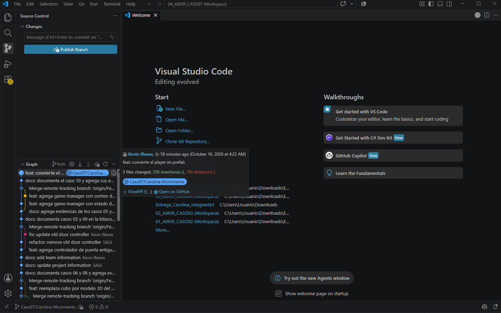

**Caso 07 — Cambio de movimiento. Captura de Carolina.**

El diff de Player.prefab muestra speed 5 frente a speed 6. En este punto también aparece el script modificado; ese cambio inicial del script se revirtió antes de confirmar el aporte.

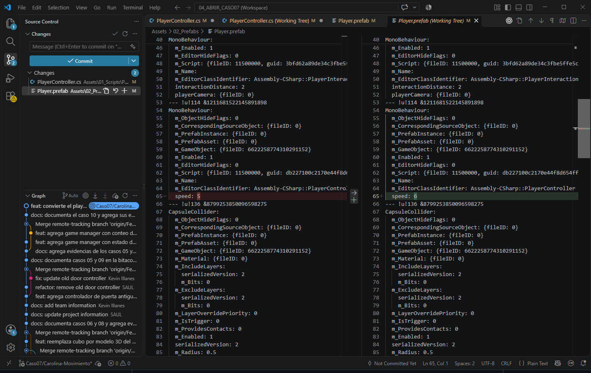

**Caso 07 — Commit de movimiento. Captura de Carolina.**

Commit ef71520, autor carolinalohrmann, con un archivo cambiado. El valor por defecto del script vuelve a 5f; el ajuste confirmado corresponde al prefab.

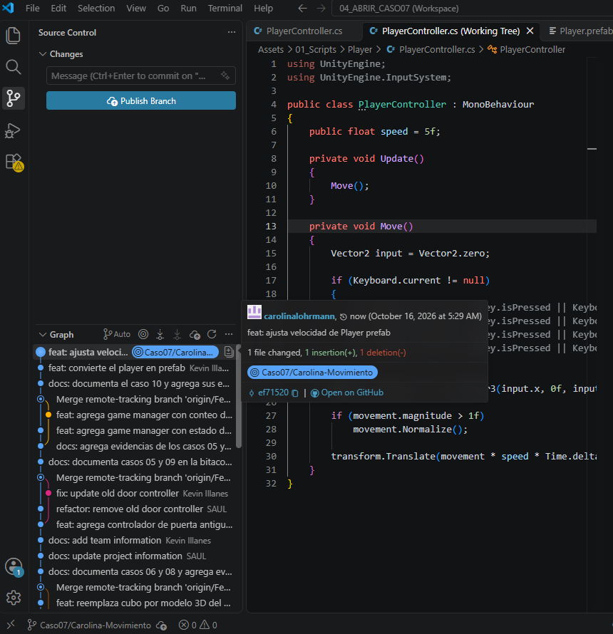

**Caso 07 — Aporte publicado. Captura de Carolina.**

GitHub muestra el repositorio, la rama Caso07/Carolina-Movimiento, Player.prefab y el commit ef71520 publicado.

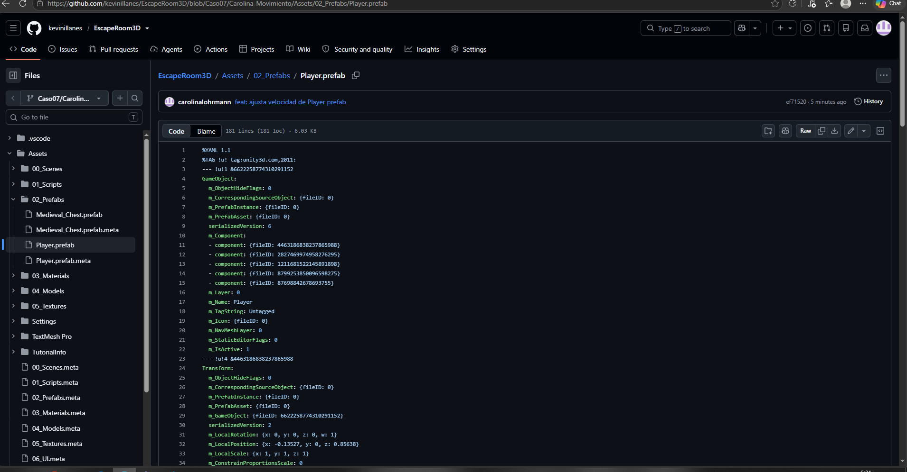

**Caso 07 — Animator añadido. Captura de Kevin.**

Unity muestra el prefab Player con Speed 5 y el componente Animator añadido antes de la integración. Controller y Avatar aparecen sin asignar.

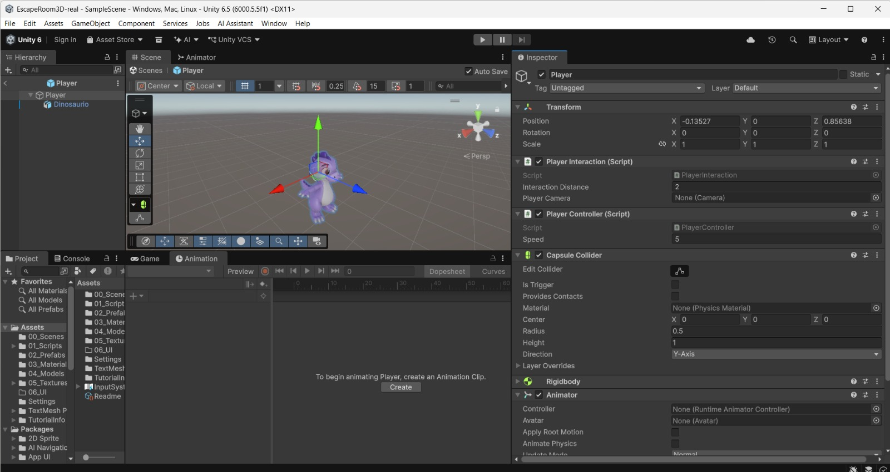

**Caso 07 — Commit de Animator. Captura de Kevin.**

Feature_Animation contiene el commit 05cd475, con autor Kevin Illanes. Los tres cambios locales de configuración visibles no forman parte de ese commit.

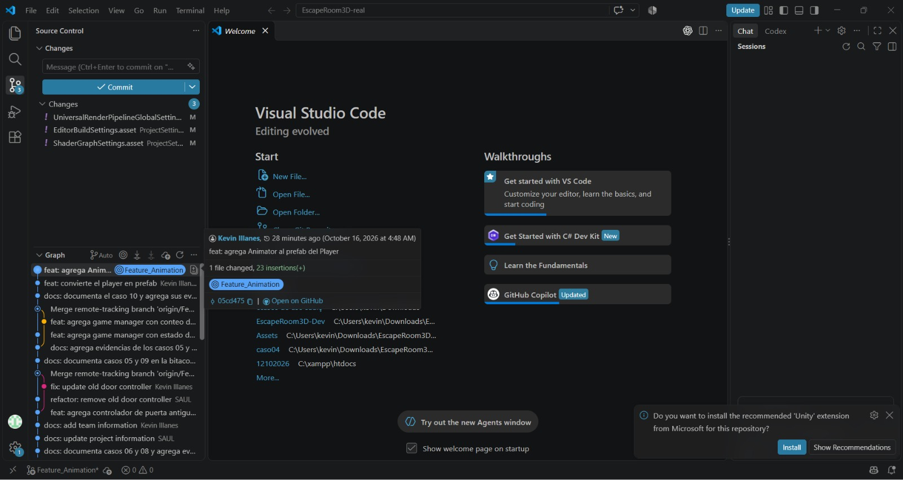

**Caso 07 — Merge automático. Captura de Carolina.**

La rama Caso07/Integracion reúne ambos aportes en bd26a4f. Source Control está limpio; no hubo conflicto textual ni resolución mediante Merge Editor.

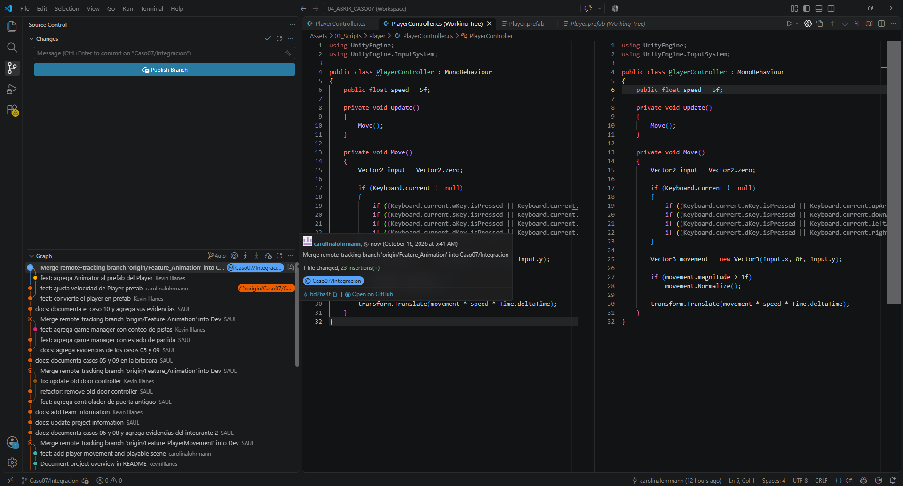

**Caso 07 — Velocidad conservada. Captura de Carolina.**

El archivo Player.prefab integrado conserva speed 6 en el componente PlayerController.

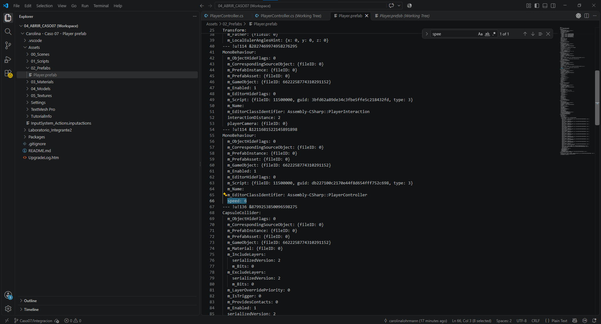

**Caso 07 — Animator conservado. Captura de Carolina.**

El prefab integrado contiene el bloque Animator y sus propiedades serializadas, junto al aporte de movimiento.

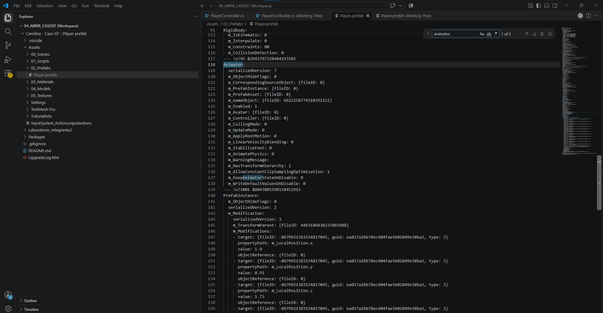

**Caso 07 — Inspector del resultado integrado. Captura de Kevin.**

Unity muestra Speed 6 y Animator en el prefab. El componente Animator no tiene Controller ni Avatar asignados; esta imagen documenta los componentes presentes.

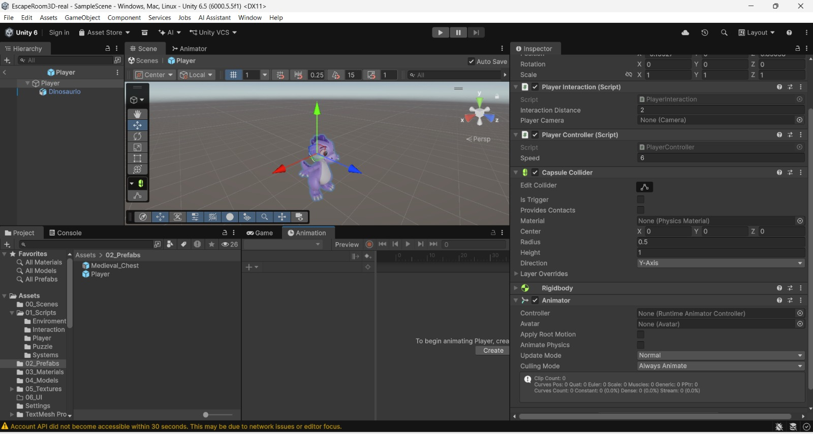

**Caso 07 — Ejecución en Unity. Captura de Kevin.**

Modo Play activo, Game y Console visibles y Speed 6 en el Inspector del prefab. La Console muestra una advertencia de Account API. La imagen documenta la ejecución; la prueba de movimiento fue confirmada por el equipo.

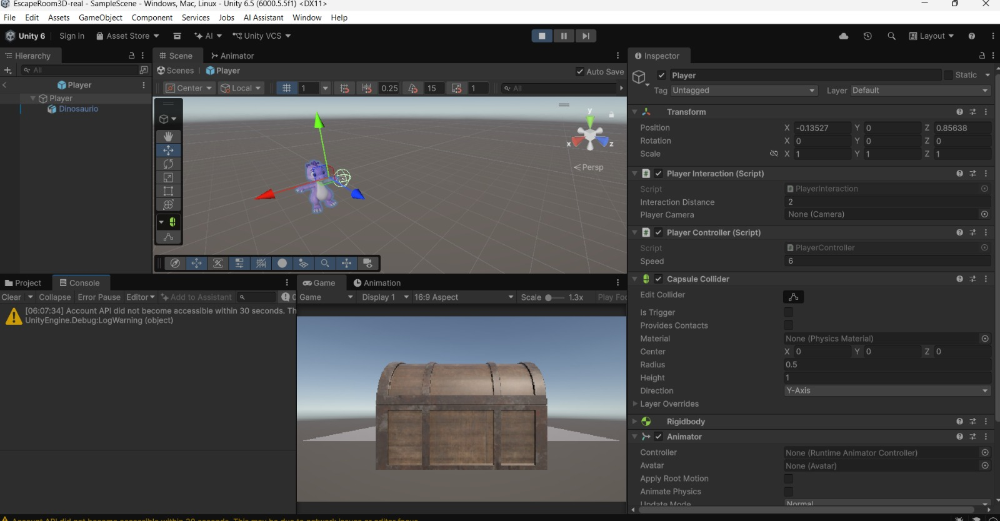

**Caso 07 — Dev publicada. Captura de Carolina.**

Dev y origin/Dev apuntan a bd26a4f, al igual que la rama de integración. No aparecen cambios pendientes ni commits por subir.

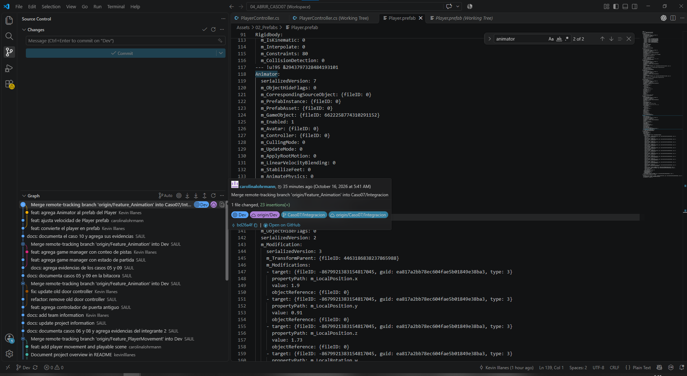
