# Bitácora y reflexiones — Carolina Lohrmann

Integrante 1 · 15 de octubre de 2026

## Reflexión Caso 01 (Repositorio y archivos ignorados)

Revisé el repositorio del equipo en GitHub, donde aparecen las carpetas de Unity, .gitignore y el README con los integrantes. El inicio del repositorio corresponde a Kevin; mi captura documenta la revisión del proyecto existente.

**¿Por qué no conviene subir Library/?** Porque Unity la genera automáticamente y puede reconstruirla. Pesa mucho y añade cambios innecesarios al repositorio.

**¿Qué diferencia hay entre un archivo ignorado y uno rastreado?** Un archivo no versionado que coincide con .gitignore normalmente no se añade a Git. Si ya está rastreado, Git lo sigue controlando aunque se agregue una regla para ignorarlo.

**¿Qué información representa un commit?** Guarda una versión de los archivos del proyecto, con autor, fecha, mensaje y relación con el historial. Su hash permite identificarlo.

**¿Qué función cumple el repositorio remoto?** Permite compartir los avances, conservar el historial del equipo y revisar los cambios en GitHub.

Aprendí que hay que revisar qué archivos se comparten y distinguir el trabajo original del equipo de mi revisión personal. La captura de GitHub no reemplaza las evidencias del problema inicial ni la prueba de Unity.

Capturas:

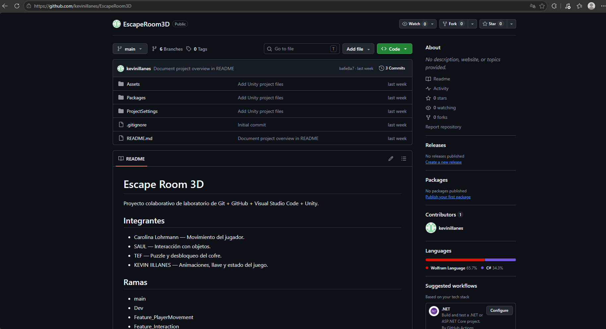

## Reflexión Caso 02 (Rama creada desde el origen incorrecto)

En la práctica local creé Feature_PlayerMovement desde main por error. Como todavía no tenía commits propios, cambié a Dev, eliminé la rama equivocada y la creé otra vez desde Dev.

**¿Desde qué commit nació mi Feature?** Primero nació desde ba6e8a7 de main. Después de corregirla, nació desde 6ccd160 de Dev. Estos hashes corresponden a la práctica local, no a una recreación publicada en GitHub.

**¿Por qué una Feature no debería nacer directamente de main en este laboratorio?** Porque Dev contiene los avances que el equipo usa como base de desarrollo. Partir de main puede dejar fuera cambios necesarios.

Aprendí a comprobar la rama actual antes de crear otra y a revisar el gráfico para confirmar su origen.

Capturas:

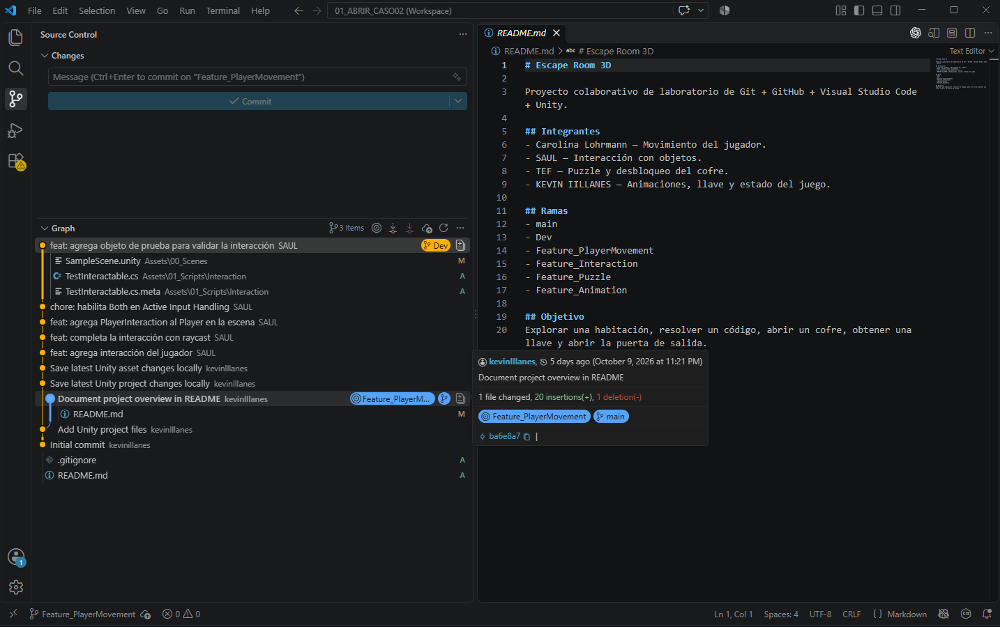

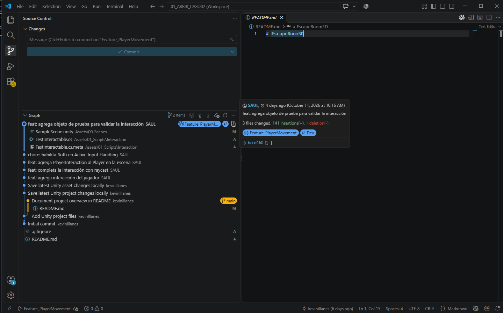

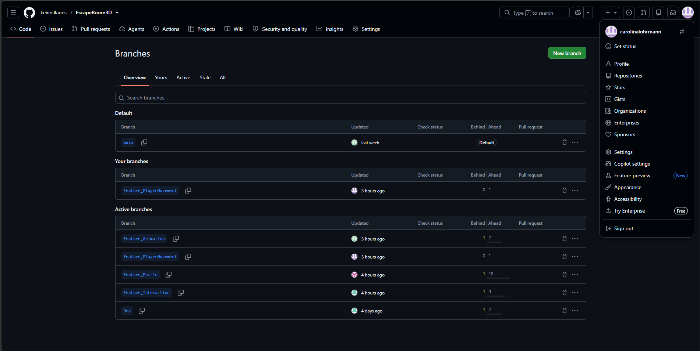

## Reflexión Caso 03 (Commit en la rama equivocada)

La base ya tenía movimiento WASD. Con asistencia preparé el cambio para añadir flechas y realicé las operaciones de Git desde Source Control. Creé el commit feat: add player movement en Dev, con mi usuario carolinalohrmann y hash 65ee4d2. Después creé Feature_PlayerMovement para conservarlo y corregí Dev con Undo Last Commit, retirando únicamente ese cambio. Dev volvió a 6ccd160 y la Feature conservó mi commit.

**¿Qué significa que una rama apunte a un commit?** Significa que esa rama tiene como referencia ese punto del historial. Por eso pude conservar el commit en la Feature aunque Dev volviera al estado anterior.

**¿Por qué no copiar el archivo a otra rama y borrar el original?** Porque eso no conserva la operación original como solución del historial. Es mejor conservar el commit en la rama correcta y corregir la referencia equivocada sin perder el trabajo.

Aprendí que antes de deshacer un commit debo comprobar dónde está conservado y si ya se compartió. La corrección de esta práctica fue local y no se publicó en Dev.

Capturas:

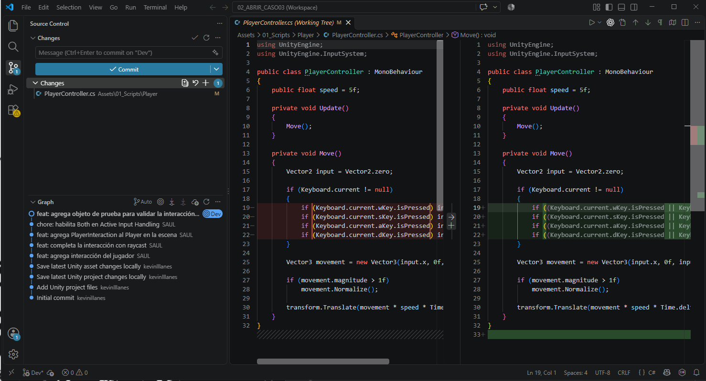

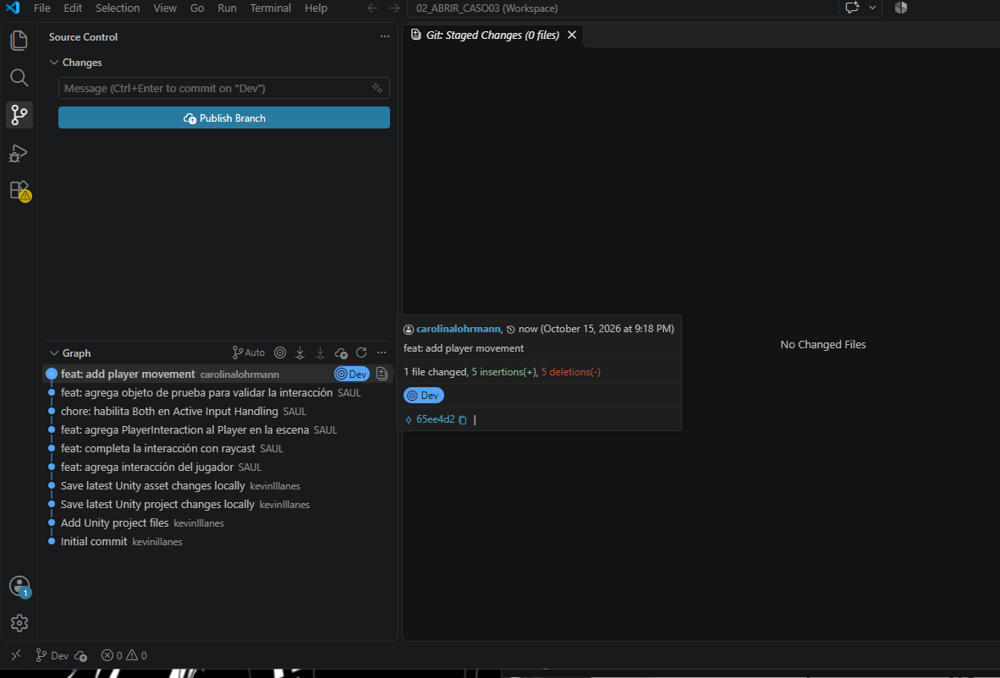

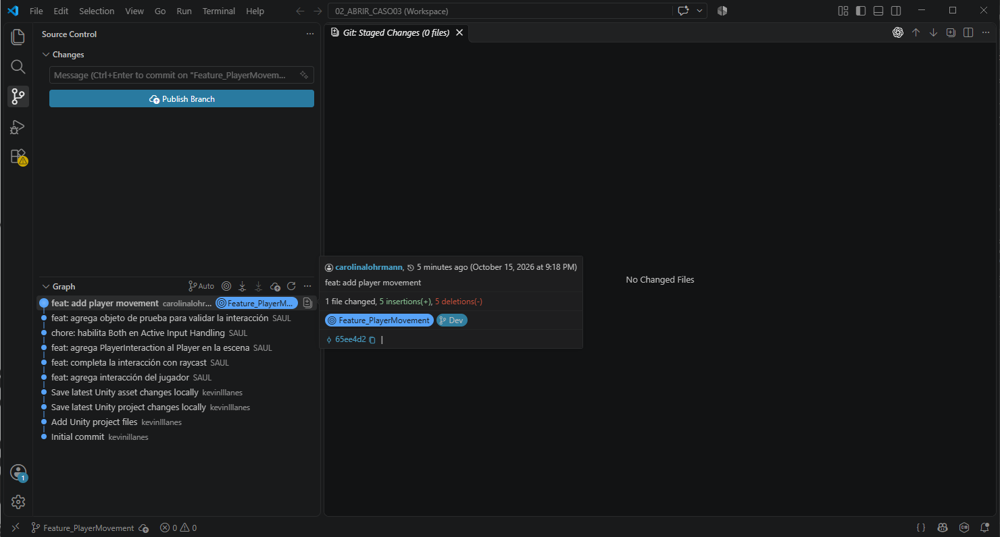

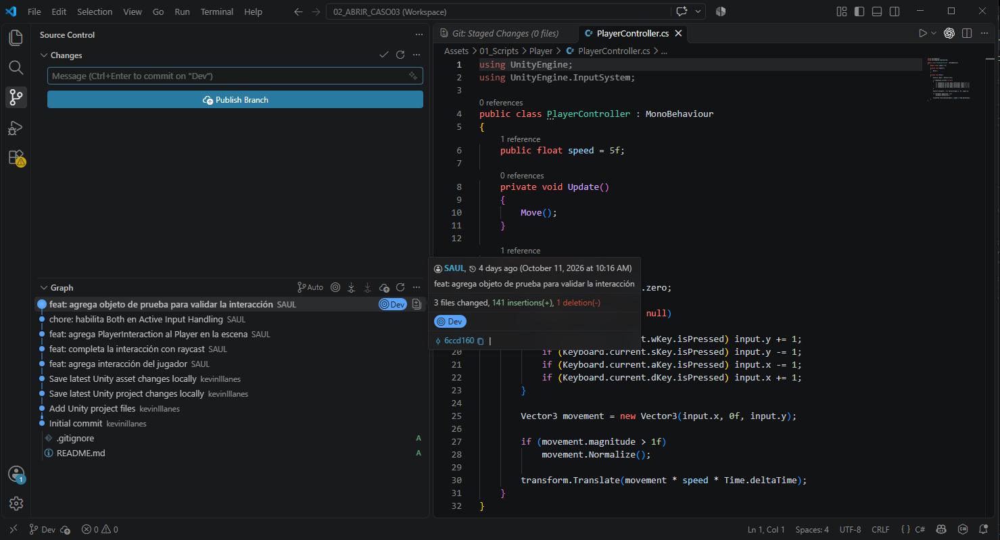

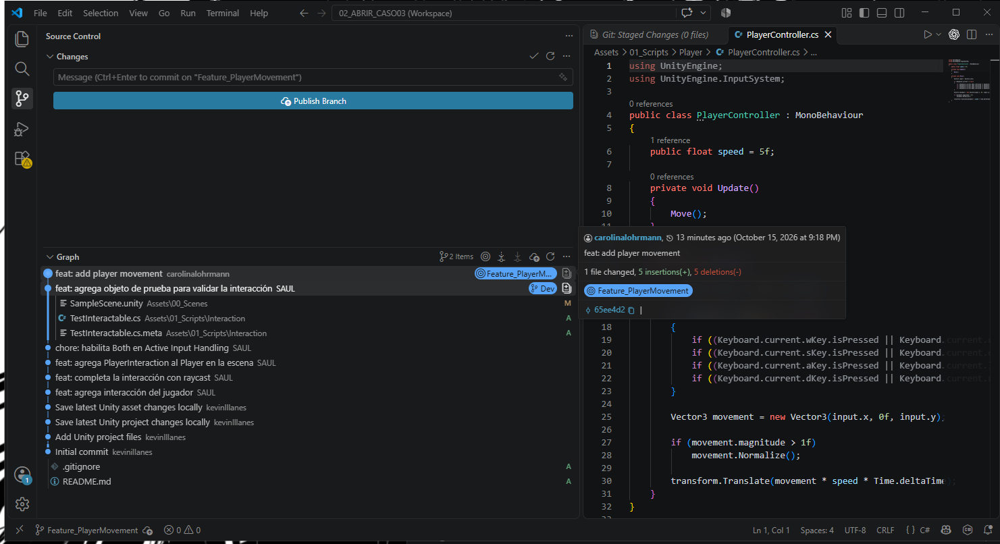

La captura de Unity es anterior y sirve como apoyo: muestra EscapeRoom3D-Dev en Play, pero no acredita la prueba de esta copia actual ni muestra Console abierta.

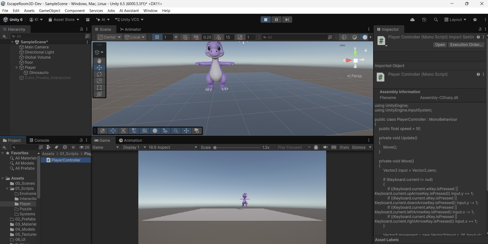

## Reflexión Caso 04 (Cambios locales y Stash)

Modifiqué PlayerInteraction.cs sin hacer commit. Al cambiar a Practica/StashDestino apareció la advertencia de que se sobrescribirían mis cambios. Cancelé y guardé el trabajo con Stash. Conservé un stash inicial con nombre automático y después otro llamado WIP interaction.

Al aplicar el stash en la rama destino apareció un conflicto. Revisé las versiones, conservé el contenido original de esa rama y mantuve el stash. Después volví a Feature_Interaction y apliqué WIP interaction: recuperé el mismo cambio sin conflictos y sin crear un commit.

**¿Qué problema resuelve Stash?** Guarda temporalmente cambios locales para cambiar de rama o de tarea sin crear un commit incompleto.

**¿Por qué Stash no reemplaza a Commit?** Porque es un almacenamiento local y temporal. Los commits forman el historial que se puede compartir; los stashes no se publican con un Push normal de la rama.

**¿Qué puede ocurrir al aplicar un stash sobre una rama que cambió?** Puede aparecer un conflicto si las dos versiones modificaron la misma zona. Me ocurrió al aplicarlo en la rama destino; pude recuperar el trabajo porque conservé el stash.

Aprendí a comprobar la rama antes de aplicar el stash y a usar Apply para mantenerlo hasta verificar la recuperación.

Capturas:

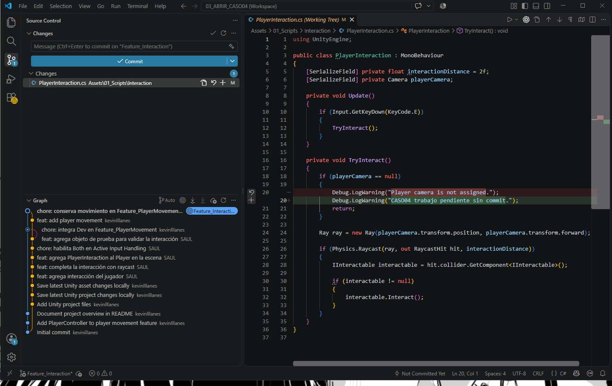

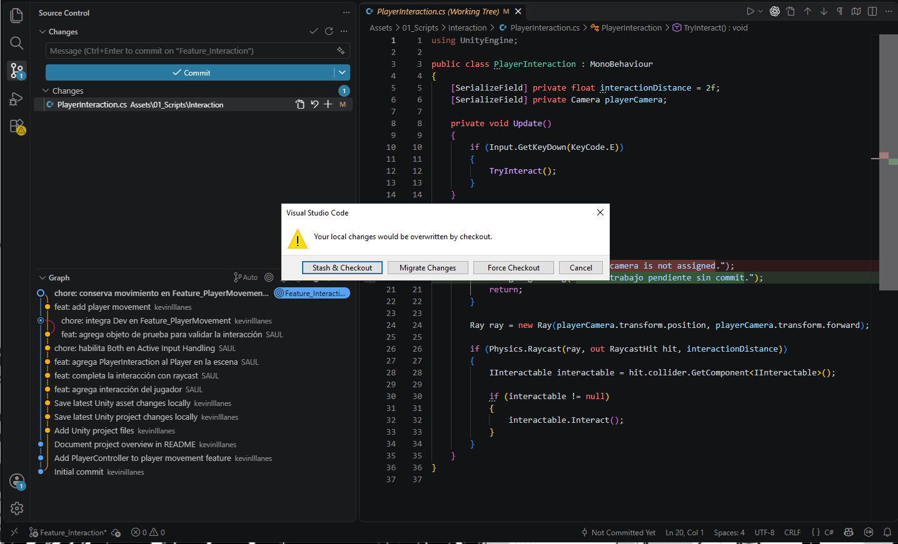

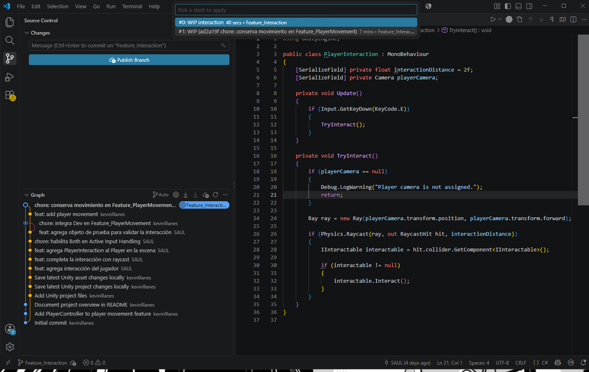

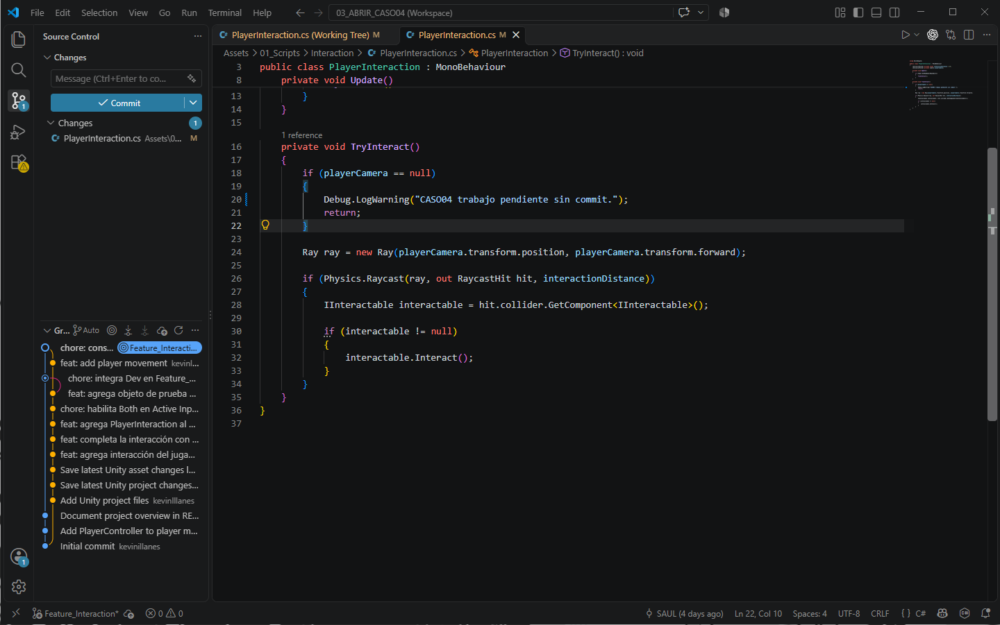

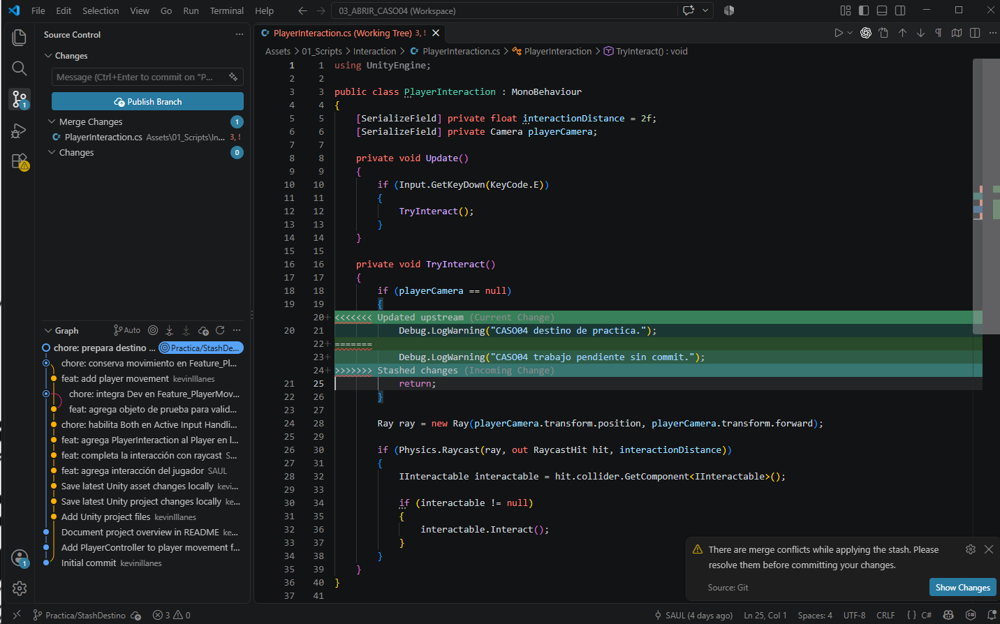
