# Bitácora y reflexiones — Kevin Illanes

Integrante 4 · 16 de octubre de 2026

## Responsabilidad en el proyecto

Mi parte del Escape Room 3D fue completar las animaciones del dinosaurio, el cofre y la puerta, implementar la llave y coordinar el estado general del juego. El flujo final permite mover al dinosaurio, resolver el código `1234`, abrir el cofre, recoger la llave y abrir la puerta para escapar.

Mis commits funcionales principales fueron:

- `3d445cb` — `feat: add procedural dinosaur movement animation`.
- `5d6e095` — `feat: add animated chest key and escape flow`.

También coordiné los casos 16 al 20 del laboratorio. Las ramas auxiliares conservan cada problema deliberado y su solución sin contaminar la versión estable del juego.

## Caso 16 — Accept Both rompe el juego

Preparé dos ramas desde una misma base. `Caso16/Initialize-A` agregó `Initialize()` en el método `Start`, mientras `Caso16/Initialize-B` agregó `InitializeGameState()`. Ambas ramas modificaron la misma línea y al integrarlas apareció un conflicto real en `GameManager.cs`.

Para reproducir el problema seleccioné **Incoming + Current**, equivalente a Accept Both. El archivo quedó con las dos llamadas. Aunque el código compilaba, `InitializeGameState()` también llamaba internamente a `Initialize()`, por lo que Unity ejecutó la inicialización dos veces. La Console mostró los mensajes “Initialize ejecutado 1 vez” e “Initialize ejecutado 2 veces”.

El merge que reproduce el problema es `2c3a811`. La solución fue revisar la lógica y dejar una sola llamada. La corrección quedó en `a680f06` con el mensaje `fix: remove duplicate game initialization`.

**¿Por qué Accept Both no garantiza una solución correcta?** Porque Git combina líneas de texto y no conoce la intención del programa. Dos líneas válidas pueden duplicar una operación que solo debe ejecutarse una vez.

**¿Qué comprobación fue necesaria?** Abrir Unity y ejecutar el juego. Quitar los marcadores del conflicto no bastaba; la duplicación solo se hizo evidente al observar la Console.

### Capturas del caso 16

**Conflicto real en `GameManager.cs`.** Source Control muestra el archivo en Merge Changes y la terminal registra el conflicto entre las dos ramas.

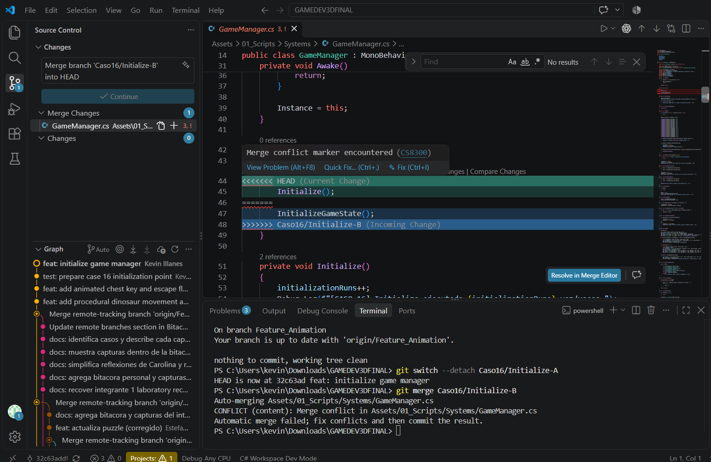

**Resolución incorrecta con Accept Both.** El resultado conserva `InitializeGameState()` e `Initialize()`.

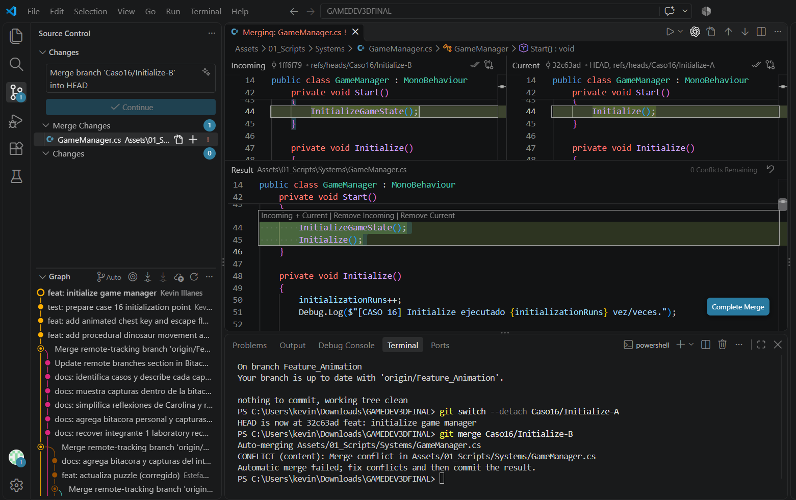

**Fallo comprobado en Unity.** La Console registra dos ejecuciones de la inicialización.

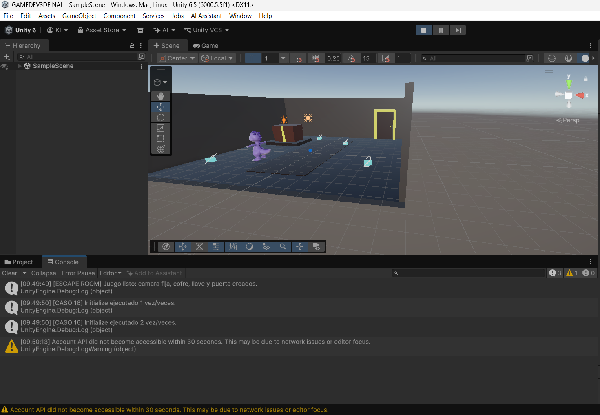

**Solución final.** `Start()` conserva una sola llamada y el historial muestra el commit de corrección encima del merge problemático.

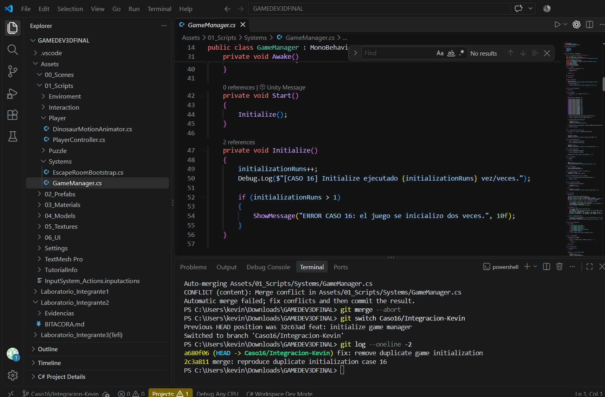

## Caso 17 — Revert de un cambio compartido

En `Caso17/Revert-Kevin` cambié deliberadamente la condición de `DoorController`. El commit `7e3af48`, `test: break door key validation for case 17`, comprobaba `GameManager.Instance.HasKey` sin negación. Como consecuencia, la puerta podía abrirse cuando el jugador no tenía la llave y lo rechazaba cuando sí la tenía.

El cambio se publicó para representar un commit compartido. Por esa razón no correspondía borrarlo con Reset. Ejecuté Revert y se creó `6845a2e`, `Revert "test: break door key validation for case 17"`. El historial conserva tanto el error como la corrección.

**¿Por qué utilicé Revert?** Porque añade un commit inverso sin reescribir la historia que otros integrantes pudieron descargar.

**¿Qué riesgo tendría usar Reset después de publicar?** Obligaría a mover la rama remota hacia atrás y podría separar o eliminar del historial visible el trabajo descargado por otras personas.

### Capturas del caso 17

**Commit defectuoso.** La condición usa `HasKey` sin negación y la terminal identifica el commit `7e3af48`.

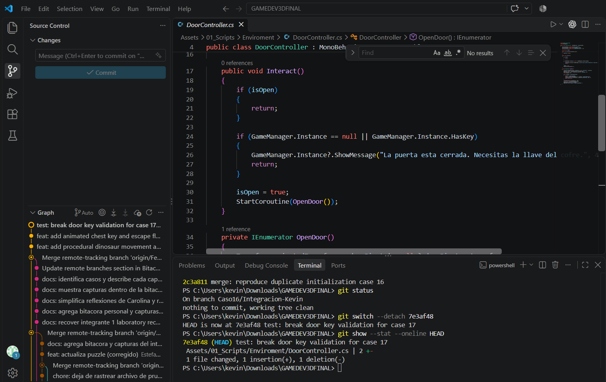

**Comportamiento roto.** El juego permite completar el escape sin haber obtenido la llave.

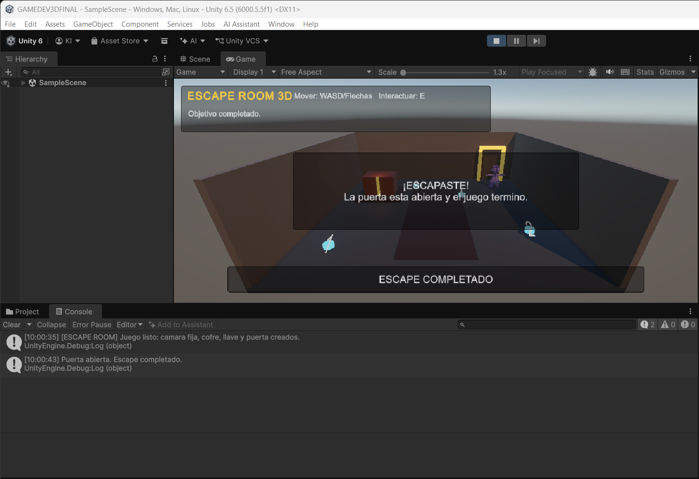

**Revert y condición restaurada.** La condición vuelve a usar `!GameManager.Instance.HasKey` y los dos commits permanecen en el historial.

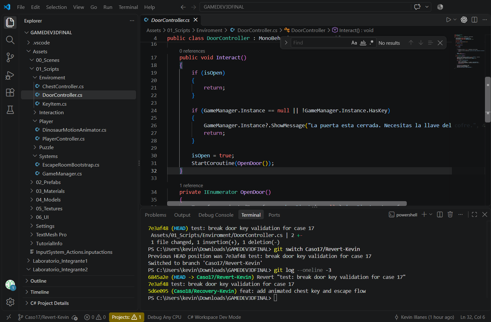

## Caso 18 — Recuperación mediante Reflog

Creé `RECOVERY_TEST.md` y el commit `426fd14eb5186f5e1a7449aba0a06b9aa09d2853`, `test: recovery point`. Después moví la rama `Caso18/Recovery-Kevin` a su commit anterior con Reset. El archivo desapareció y la rama volvió a `5d6e095`.

El commit no estaba visible en el historial normal de esa rama, pero `git reflog` registró tanto el commit como el movimiento `reset: moving to HEAD~1`. Utilicé el hash exacto para crear `Caso18/Recovered-Kevin`. La nueva rama volvió a apuntar a `426fd14` y `RECOVERY_TEST.md` apareció nuevamente.

**¿Por qué Reflog pudo encontrar el commit?** Porque registra localmente los lugares por los que pasaron `HEAD` y las referencias, incluso cuando una rama deja de señalar un commit.

**¿Reflog reemplaza a una rama remota?** No. Es un registro local y temporal. Después de recuperar un trabajo importante conviene crear una referencia y publicarla.

### Capturas del caso 18

**Archivo desaparecido.** `Test-Path` devuelve `False` y la rama apunta al commit anterior.

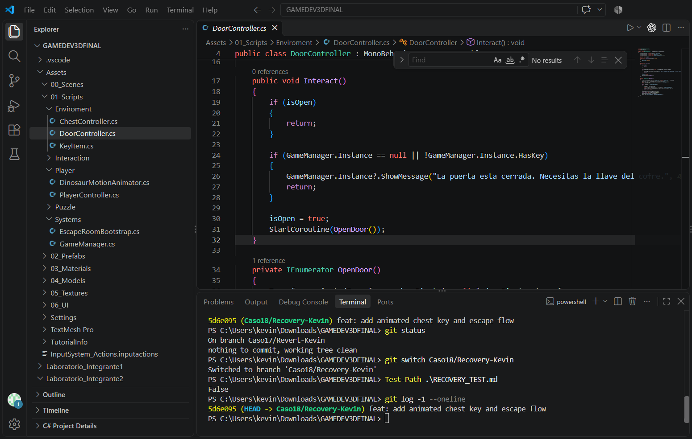

**Búsqueda en Reflog.** Aparecen el Reset y el commit `426fd14`.

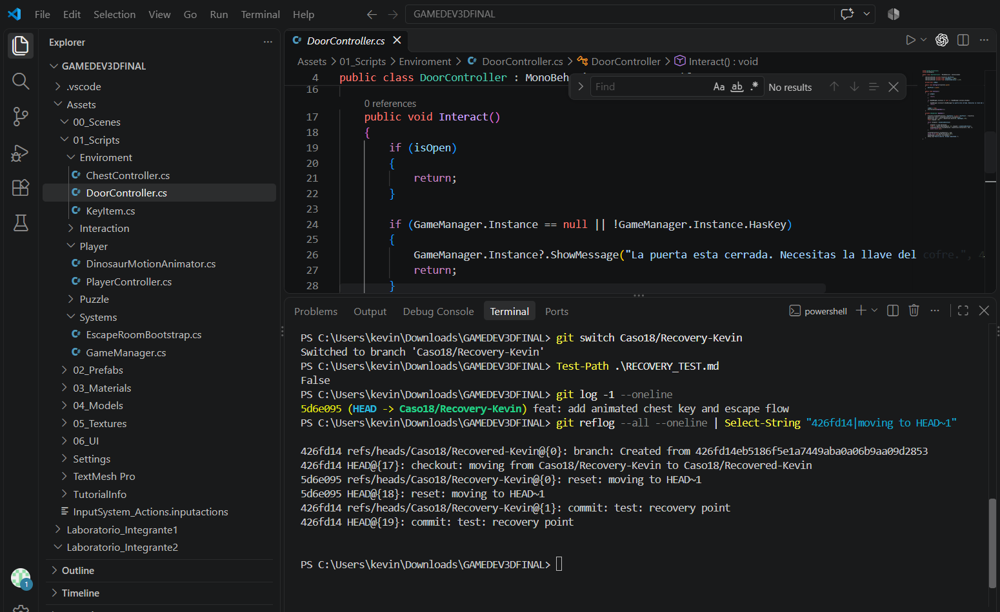

**Commit recuperado.** La rama recuperada apunta nuevamente a `426fd14` y `Test-Path` devuelve `True`.

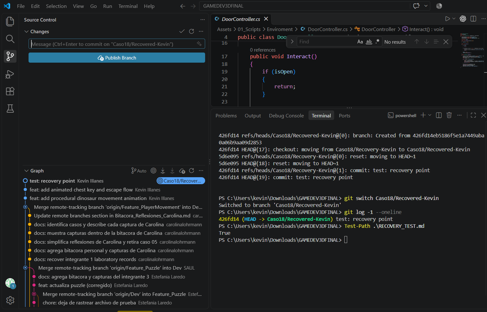

**Contenido recuperado.** VS Code vuelve a mostrar `RECOVERY_TEST.md`.

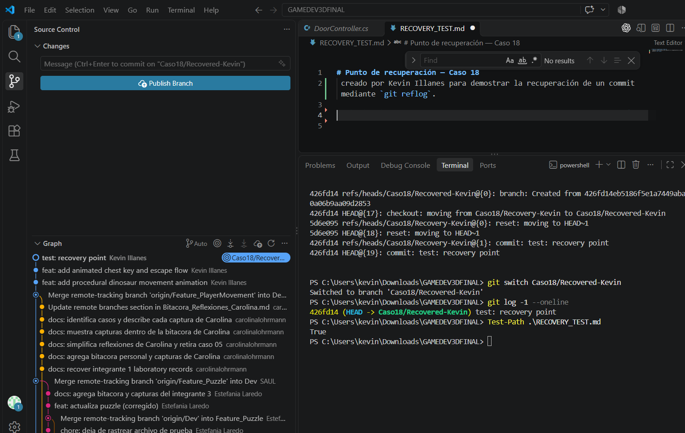

## Caso 19 — Cherry-pick selectivo

La rama `Caso19/Feature-Puzzle-Source` se creó desde Dev y recibió tres commits consecutivos:

1. `18e42f4` — `docs: add puzzle ui note`.
2. `50ead2b` — `fix: correct puzzle validation`.
3. `9f5b72f` — `docs: add future puzzle hint note`.

El objetivo era integrar únicamente la corrección central. Desde `Dev` ejecuté Cherry-pick sobre `50ead2b`. Git creó `36b5750` con el mismo cambio y mensaje, pero con un hash nuevo porque tiene un padre diferente. Los archivos de notas de los commits 1 y 3 no aparecieron en Dev; `Test-Path` devolvió `False` para ambos.

La corrección seleccionada eliminó la marca temporal `//prueba` y normalizó el código con `Trim()` antes de compararlo con `1234`.

**¿Qué hace Cherry-pick?** Copia el cambio introducido por un commit específico sobre la rama actual y crea un commit nuevo.

**¿Por qué no hice Merge?** Un Merge habría integrado también los otros dos commits. El caso exigía transportar únicamente la corrección de validación.

### Capturas del caso 19

**Tres commits en la rama fuente.** El historial muestra las dos notas y la corrección separadas.

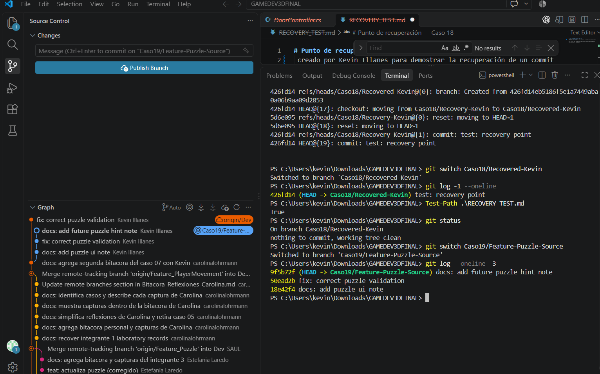

**Contenido del commit seleccionado.** El diff muestra la eliminación de `//prueba` y la incorporación de `Trim()`.

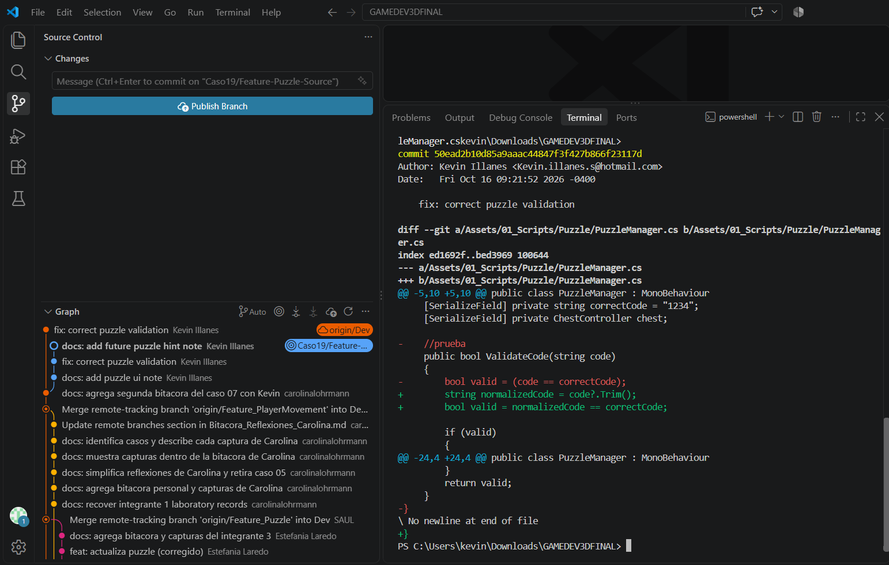

**Resultado en Dev.** La corrección aparece como `36b5750` después del Cherry-pick.

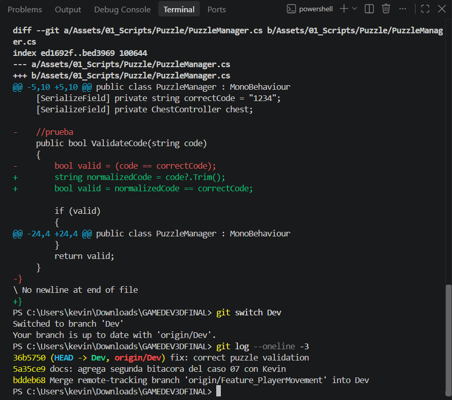

**Verificación selectiva.** Dev está activa y los dos archivos de notas devuelven `False`.

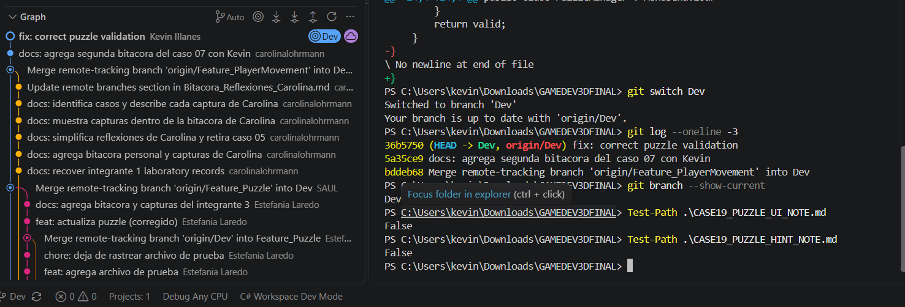

## Caso 20 — Revisión colaborativa y Pull Requests finales

Actualicé `Feature_Animation` con Dev y resolví el conflicto de `PuzzleManager.cs` conservando `Configure(...)` y la validación normalizada. Unity 6000.5.5f1 compiló `Assembly-CSharp` y `Assembly-CSharp-Editor` con cero errores C#.

Abrí el Pull Request #1 desde `Feature_Animation` hacia `Dev`. Solicité la revisión de Carolina Lohrmann desde su cuenta `carolinalohrmann`. Carolina revisó `ChestController.cs` y pidió validar que existiera un `PuzzleManager` antes de activar el canvas o iniciar el puzzle, porque la interfaz podía quedar abierta sin un puzzle disponible.

Modifiqué `ChestController.Interact()` para buscar primero el componente. Si sigue siendo nulo, ahora registra una advertencia, muestra un mensaje al jugador y termina la interacción. El canvas solo se activa después de superar esa validación. La corrección se publicó en `3c01b17`, `fix: validate puzzle manager before opening UI`.

Respondí la conversación con el hash y la validación realizada. Carolina comprobó el resultado, resolvió la conversación y aprobó el Pull Request. Finalmente integré el PR #1 en Dev mediante `41e80fd`. Después probé en Unity el flujo completo del juego y lo registré en video. El Pull Request #2 de Dev hacia main quedó abierto para la integración final del equipo.

**¿Qué aporta un Pull Request?** Permite comparar ramas, discutir líneas concretas, pedir cambios y conservar quién revisó y aprobó antes de integrar.

**¿Por qué la aprobación debía hacerla otra persona?** Porque una autoaprobación no demuestra colaboración ni aporta una segunda revisión del cambio.

**¿Qué aprendí de la revisión?** Una referencia nula no solo puede producir un error; también puede dejar una interfaz en un estado incoherente. El orden correcto es validar las dependencias y después cambiar la interfaz.

### Capturas del caso 20

**Solicitud recibida por Carolina.** GitHub muestra que Kevin solicitó su revisión del PR #1.

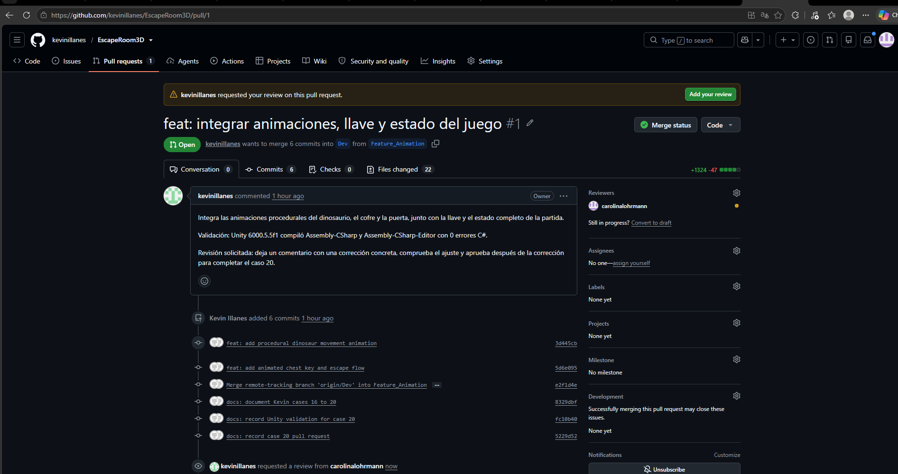

**Pull Request abierto.** El PR compara `Feature_Animation` con `Dev`, contiene seis commits iniciales y no presenta conflictos con la rama base.

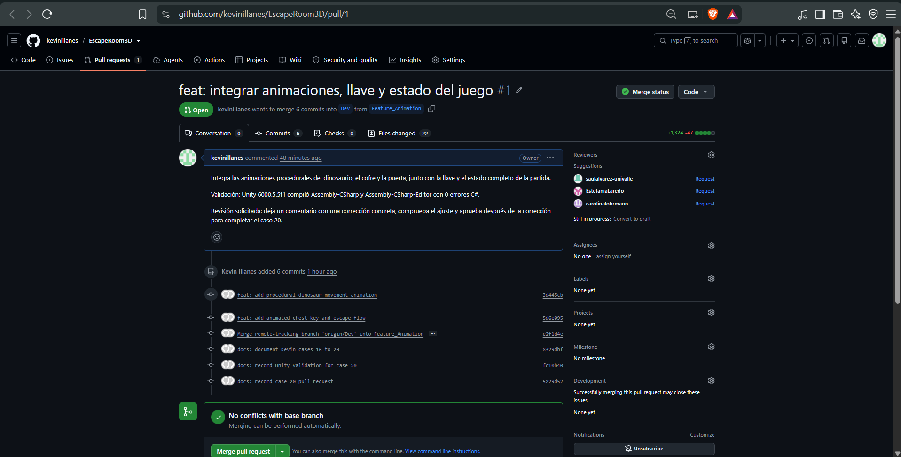

**Archivos revisados.** La pestaña Files changed muestra la implementación de `ChestController.cs` y los archivos incorporados.

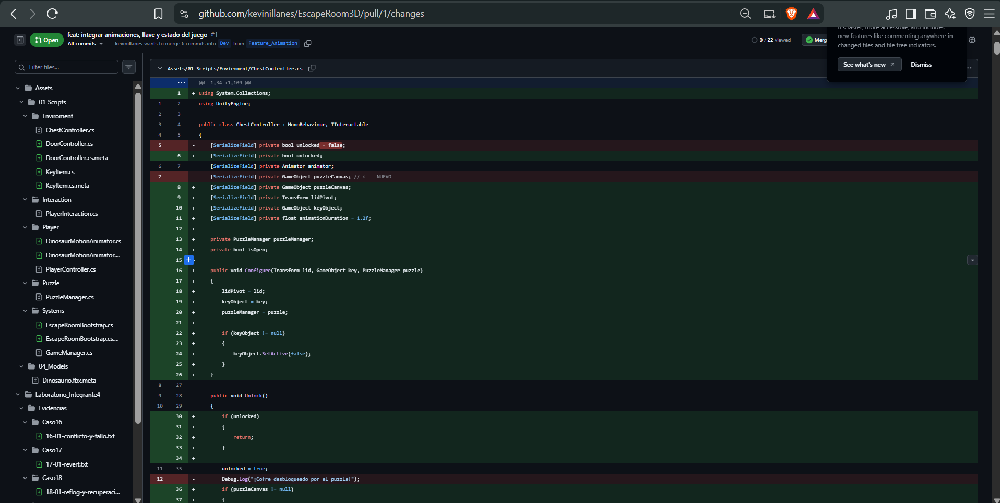

**Cambios solicitados por Carolina.** La revisión pide validar `PuzzleManager` antes de mostrar el canvas o llamar a `BeginPuzzle`.

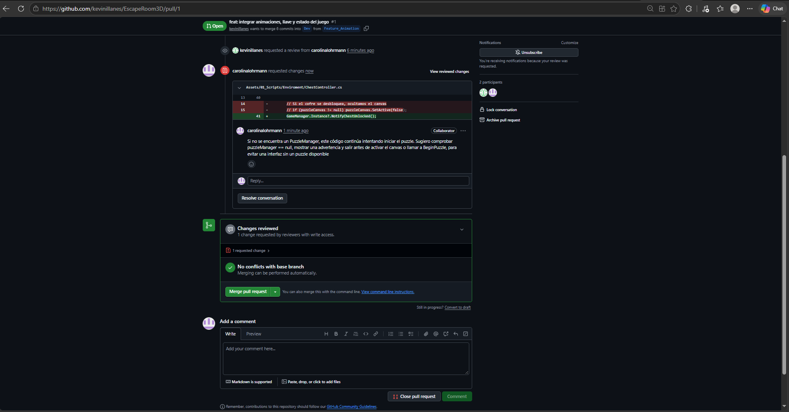

**Corrección publicada.** El diff del commit `3c01b17` busca y valida `PuzzleManager`, muestra una advertencia y retorna antes de activar el canvas cuando falta la dependencia.

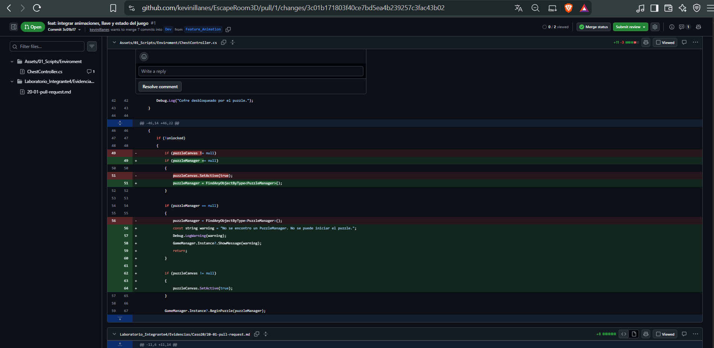

**Respuesta a la revisión.** La conversación conserva el comentario de Carolina y la respuesta de Kevin con el hash de la corrección.

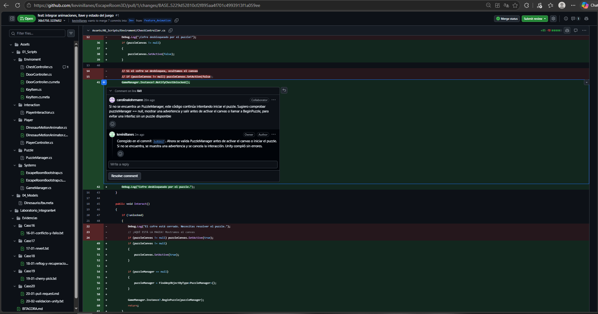

**Aprobación de Carolina.** GitHub muestra `carolinalohrmann approved these changes`, una aprobación y ausencia de conflictos con Dev.

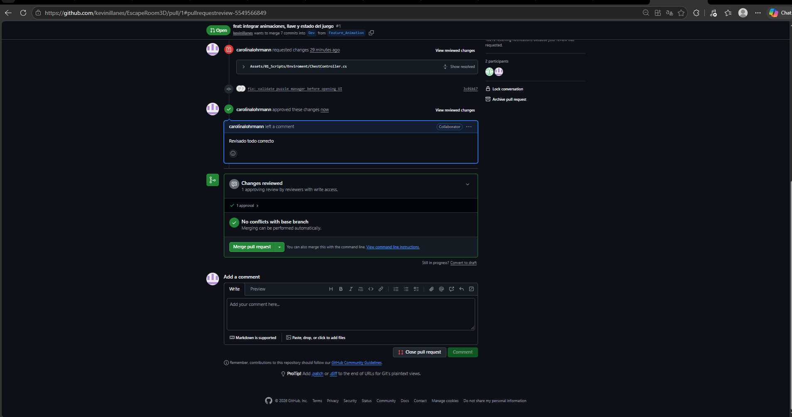

**Merge hacia Dev.** El PR aparece fusionado y cerrado mediante `41e80fd`; la misma vista conserva la solicitud de cambios y la aprobación.

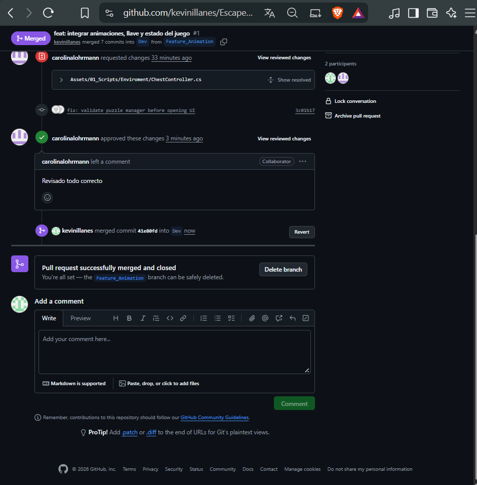

**Prueba final en Unity.** El video muestra el recorrido funcional completo hasta `ESCAPE COMPLETADO`.

[Video 20-07 — Prueba final en Unity](../Capturas/Caso20/20-07-prueba-final-unity.mp4)

## Resultado final

Los cinco casos asignados quedaron reproducidos y resueltos con historia verificable. La versión funcional y las evidencias están en Dev. Los Pull Requests utilizados fueron:

- PR #1, `Feature_Animation` hacia `Dev`: https://github.com/kevinillanes/EscapeRoom3D/pull/1
- PR #2, `Dev` hacia `main`: https://github.com/kevinillanes/EscapeRoom3D/pull/2

La rama `Feature_Animation` conserva mi trabajo individual. Dev contiene el resultado revisado, aprobado, probado e integrado con el equipo.
